<p align="center">
  
</p>

<p align="center">
  <a href="https://tarunnahak.in"><code>tarunnahak.in</code></a> ·
  <a href="https://linkedin.com/in/tarunnahak"><code>linkedin/tarunnahak</code></a> ·
  <a href="https://www.npmjs.com/~tarunnahak"><code>npm/~tarunnahak</code></a>
</p>

### `$ systemctl status tarun`

<pre>
● tarun.service - Senior Software Engineer
     Loaded: loaded (/work/siemens; enabled; previous: /archive/mercedes-benz)
     Active: <b>active (running)</b> in Bengaluru, IN
      Focus: backend services · distributed systems · developer tooling
   Studying: M.Tech in AI @ IIT Bhilai (in progress)
  Mentoring: Airtribe · Node.js backend track: system design, LLD, mock interviews
       Docs: <a href="https://tarunnahak.in">https://tarunnahak.in</a>
</pre>

### `$ ls -l ~/projects`

<pre>
total 4
drwxr-xr-x  tarun  go    <a href="https://github.com/nahaktarun/godevtool"><b>godevtool/</b></a>
            └─ debugging toolkit for Go: structured logs, profiling, goroutine leaks,
               HTTP + gRPC tracing, live dashboard. 26 pkgs, 180 tests, zero deps
drwxr-xr-x  tarun  node  <a href="https://github.com/nahaktarun/API_Gateway"><b>flight-booking/</b></a>
            └─ 5 microservices on RabbitMQ: gateway, auth, booking, search, reminders
drwxr-xr-x  tarun  go    <a href="https://github.com/nahaktarun/go-grpc"><b>go-grpc/</b></a>
            └─ all four gRPC modes: unary, server, client and bidirectional streaming
-rwxr-xr-x  tarun  npm   <a href="https://www.npmjs.com/package/express-route-lister"><b>express-route-lister</b></a>
            └─ CLI that lists every route in an Express app, published on npm
</pre>

### `$ ls -l ~/mentoring`

<pre>
total 3
drwxr-xr-x  tarun  ts    <a href="https://github.com/nahaktarun/amazon-locker-lld"><b>amazon-locker-lld/</b></a>
            └─ an LLD round end to end: God class → designed system, one commit
               per step, plus a double-booking race fixed with atomic compare-and-set
drwxr-xr-x  tarun  deck  <a href="https://github.com/nahaktarun/lld-interview-prep"><b>lld-interview-prep/</b></a>
            └─ OOP, SOLID, patterns, then parking lot, elevator, Splitwise, BookMyShow
drwxr-xr-x  tarun  docs  <a href="https://github.com/nahaktarun/nodejs-backend-mock-interview"><b>nodejs-backend-mock-interview/</b></a>
            └─ ~90 laddered questions, coding drills, an LLD round and a scorecard
</pre>

### `$ cat ~/.config/stack.toml`

```toml
[core]
languages = ["Go", "Rust", "TypeScript", "C++", "Python"]

[backend]
apis       = ["gRPC", "GraphQL", "REST"]
frameworks = ["NestJS", "FastAPI"]

[infra]
cloud = ["Kubernetes", "AWS", "Google Cloud"]
ops   = ["Linux", "Nginx", "Jenkins"]

[data]
stores = ["Redis", "MySQL", "MongoDB"]

[also]
frontend = ["React", "Next.js", "Tauri"]
ml       = ["TensorFlow"]
```

### `$ git log --graph --all`

<picture>
  <source media="(prefers-color-scheme: dark)" srcset="https://raw.githubusercontent.com/nahaktarun/nahaktarun/output/snake-dark.svg" />
  <source media="(prefers-color-scheme: light)" srcset="https://raw.githubusercontent.com/nahaktarun/nahaktarun/output/snake-light.svg" />
  
</picture>

```console
$ exit
logout
Connection to nahaktarun closed.
```
